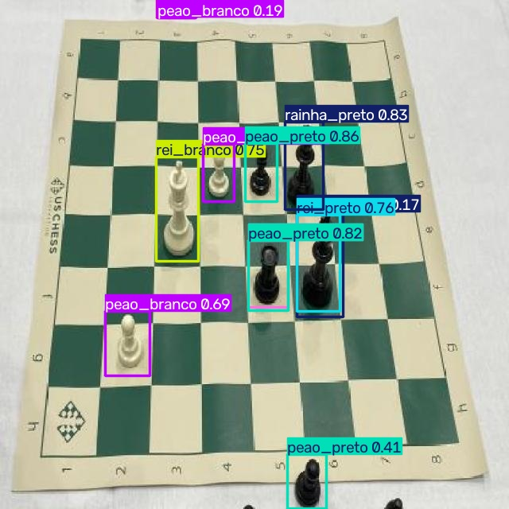
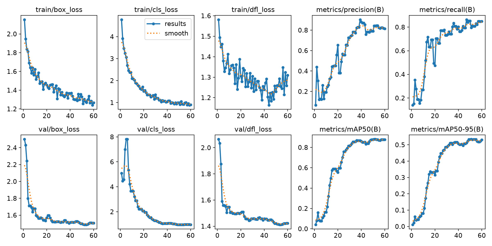
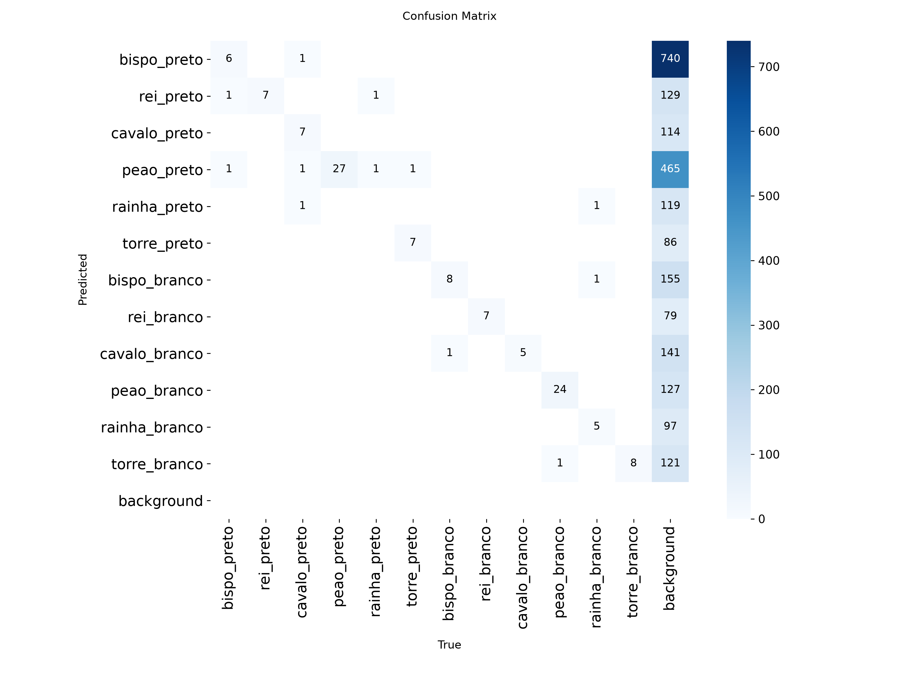
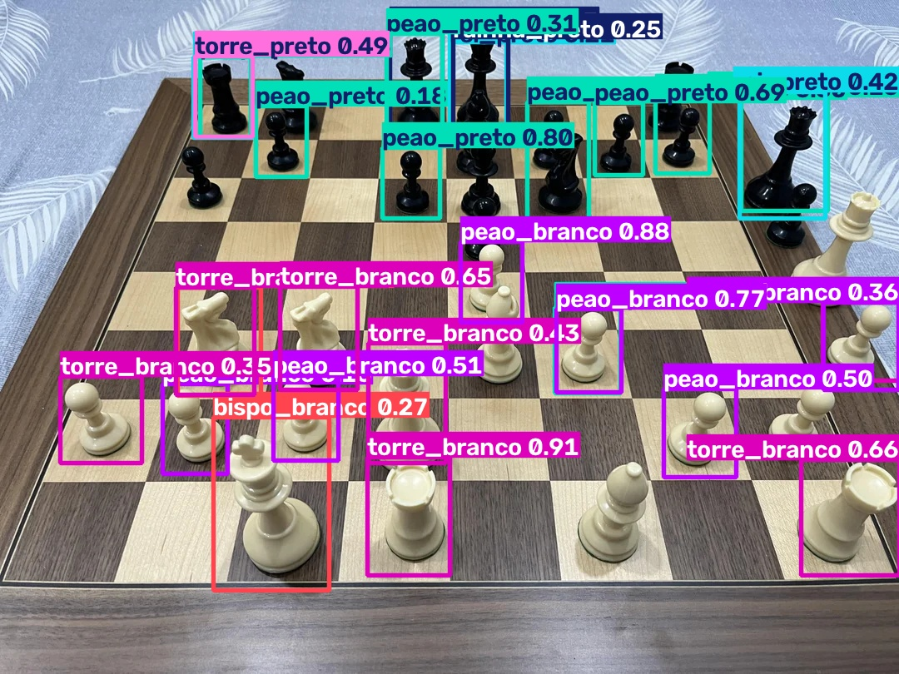

# ♟️ Identificação de Peças de Xadrez com YOLOv8 + FastAPI

Projeto de visão computacional que **detecta e classifica peças de xadrez** em imagens usando um modelo YOLOv8 treinado em um dataset próprio. O modelo é disponibilizado por uma **API REST em FastAPI**, que recebe uma imagem e retorna as detecções em JSON.



---

## 1. Dataset

O dataset é composto por fotos de tabuleiros e de peças de xadrez, anotadas com caixas delimitadoras (*bounding boxes*) e exportadas do **Roboflow** no formato YOLO (um arquivo `.txt` por imagem, com `classe x_centro y_centro largura altura` normalizados entre 0 e 1).

| Conjunto  | Imagens | Objetos anotados |
|-----------|--------:|-----------------:|
| Treino    | 41      | 252              |
| Validação | 12      | 123              |

### Classes (12)

O modelo diferencia **o tipo e a cor** de cada peça:

| ID | Classe          | Objetos (treino / validação) |
|---:|-----------------|-----------------------------:|
| 0  | `bispo_preto`   | 12 / 8   |
| 1  | `rei_preto`     | 18 / 7   |
| 2  | `cavalo_preto`  | 20 / 10  |
| 3  | `peao_preto`    | 50 / 27  |
| 4  | `rainha_preto`  | 7 / 2    |
| 5  | `torre_preto`   | 20 / 8   |
| 6  | `bispo_branco`  | 13 / 9   |
| 7  | `rei_branco`    | 20 / 7   |
| 8  | `cavalo_branco` | 15 / 5   |
| 9  | `peao_branco`   | 47 / 25  |
| 10 | `rainha_branco` | 10 / 7   |
| 11 | `torre_branco`  | 20 / 8   |

> A ordem das classes no `dataset.yaml` segue os IDs usados nos rótulos (ordem alfabética do Roboflow em inglês: *bishop, king, knight, pawn, queen, rook*, primeiro pretas e depois brancas).

### Desafio que o projeto resolve

Reconhecer automaticamente **quais peças estão no tabuleiro e onde elas estão** a partir de uma simples foto. Isso é a base para:

- **Digitalizar partidas físicas** (por exemplo, converter a posição em notação FEN e analisá-la em um motor de xadrez);
- **Transmitir partidas ao vivo** de torneios presenciais sem tabuleiros eletrônicos caros;
- **Robótica e acessibilidade**, como braços robóticos que jogam xadrez ou assistentes para pessoas com deficiência visual.

As principais dificuldades são as **peças muito parecidas entre si** (rei × rainha, bispo × peão), a **sobreposição** entre peças vistas de lado e as **variações de iluminação, ângulo e modelo** dos jogos de xadrez.

---

## 2. Modelo: YOLOv8n

Foi utilizado o **YOLOv8n (nano)** da biblioteca [Ultralytics](https://docs.ultralytics.com/), partindo dos pesos pré-treinados no COCO (`yolov8n.pt`).

**Por que essa versão:**

- **Transfer learning:** com apenas 41 imagens de treino, treinar do zero não converge. Partir de pesos pré-treinados permite que o modelo aproveite o que já sabe sobre formas e bordas e aprenda só as diferenças entre as peças.
- **Leve e rápido:** a versão *nano* tem cerca de 3,2 milhões de parâmetros. Isso permitiu **treinar no processador (sem GPU)** em poucos minutos e garante inferência rápida na API.
- **Ecossistema maduro:** a API do Ultralytics simplifica treino, validação e inferência, e o modelo exportado (`best.pt`) é carregado diretamente pela API.

### Comparação entre os treinos realizados

Todos os experimentos usaram YOLOv8n, `imgsz=640` e `batch=16`. As métricas são do conjunto de validação (melhor época de cada treino).

| Experimento | Épocas | Precisão | Recall | mAP50 | mAP50-95 |
|-------------|------:|------:|------:|------:|------:|
| `train`     | 50 | 0,907 | 0,782 | 0,863 | 0,514 |
| `train-2`   | 10 | 0,203 | 0,495 | 0,292 | 0,154 |
| `train_3`   | 60 | 0,843 | 0,796 | **0,880** | **0,534** |

**Conclusões:** 10 épocas são insuficientes para o modelo aprender as 12 classes (mAP50 de apenas 0,29). Com 50 épocas ou mais, o mAP50 passa de 0,85. O `train_3` (60 épocas) teve o melhor resultado e é o modelo usado pela API.

<p align="center">
  
  
</p>

> **Observação:** o conjunto de validação tem apenas 12 imagens, então as métricas podem variar bastante e tendem a ser otimistas. Aumentar o dataset é o próximo passo para melhorar a generalização.

---

## 3. Estrutura do projeto

```
├── api.py              # API FastAPI (endpoint /detect)
├── main.ipynb          # Notebook de treino e teste do modelo
├── dataset.yaml        # Configuração do dataset (caminhos relativos e classes)
├── requirements.txt    # Dependências
├── imagem_para_upload.jpg  # Imagem de exemplo para testar a API
├── models/
│   └── best.pt         # Modelo final (train_3, 60 épocas)
├── meu_dataset/
│   ├── train/          # images/ e labels/ de treino
│   └── valid/          # images/ e labels/ de validação
└── docs/               # Gráficos de treino e exemplos de detecção
```

> A pasta `runs/`, gerada a cada treino, não é versionada (está no `.gitignore`). Apenas o modelo final é copiado para `models/best.pt`.

---

## 4. Como executar

### 4.1 Instalar as dependências

Requer **Python 3.9+**. Na pasta do projeto:

```bash
pip install -r requirements.txt
```

### 4.2 Treinar o modelo (opcional)

Abra o `main.ipynb` **a partir da pasta do projeto** e execute as células. O treino salva o modelo em `runs/detect/<nome_do_treino>/weights/best.pt`. Para usá-lo na API, copie o arquivo para `models/best.pt`.

### 4.3 Executar a API localmente

```bash
uvicorn api:app --reload
```

> No Windows, se o comando `uvicorn` não for reconhecido, use `python -m uvicorn api:app --reload`.

A API carrega o modelo `models/best.pt`. Se ele não existir, usa o `best.pt` mais recente dentro de `runs/detect/`. Para escolher outro modelo, defina a variável de ambiente `MODEL_PATH`:

```bash
# Windows (PowerShell)
$env:MODEL_PATH="runs/detect/train/weights/best.pt"; uvicorn api:app --reload
```

Depois de ver `Application startup complete` no terminal, acesse:

- **Documentação interativa (Swagger):** http://127.0.0.1:8000/docs
- **Status da API:** http://127.0.0.1:8000/

---

## 5. Endpoints

| Método | Rota      | Descrição |
|--------|-----------|-----------|
| `GET`  | `/`       | Status da API, modelo carregado e lista de classes |
| `POST` | `/detect` | Recebe uma imagem (`multipart/form-data`, campo `file`) e retorna as detecções |

**Parâmetro opcional:** `conf` (padrão `0.5`) é a confiança mínima para uma detecção ser retornada.

A API usa `agnostic_nms=True`. Quando o modelo aponta duas classes diferentes para a mesma peça, só a de maior confiança é mantida.

### Exemplo de requisição

```bash
curl -X POST "http://127.0.0.1:8000/detect?conf=0.5" \
     -F "file=@imagem_para_upload.jpg"
```

### Exemplo de payload de saída (JSON)

A API **não retorna a imagem desenhada**, apenas os dados estruturados:

```json
{
  "arquivo": "imagem_para_upload.jpg",
  "largura_imagem": 1080,
  "altura_imagem": 810,
  "total_deteccoes": 3,
  "deteccoes": [
    {
      "classe": "peao_branco",
      "classe_id": 9,
      "confianca": 0.9382,
      "bounding_box": { "x1": 795.6, "y1": 464.8, "x2": 882.6, "y2": 573.4 }
    },
    {
      "classe": "torre_preto",
      "classe_id": 5,
      "confianca": 0.7944,
      "bounding_box": { "x1": 235.5, "y1": 69.2, "x2": 302.3, "y2": 163.1 }
    },
    {
      "classe": "rei_branco",
      "classe_id": 7,
      "confianca": 0.7942,
      "bounding_box": { "x1": 441.0, "y1": 413.7, "x2": 540.8, "y2": 679.2 }
    }
  ]
}
```

| Campo | Descrição |
|-------|-----------|
| `classe` / `classe_id` | Nome e número da peça detectada |
| `confianca` | Confiança do modelo, de 0 a 1 |
| `bounding_box` | Caixa em **pixels da imagem original**: `(x1, y1)` é o canto superior esquerdo e `(x2, y2)` o canto inferior direito |

---

## 6. Limitações conhecidas e próximos passos

O modelo tem bom desempenho em fotos parecidas com as do dataset (tabuleiro de lona, vista de cima), mas **erra bastante em cenários diferentes**. No teste abaixo, com tabuleiro de madeira, outro jogo de peças e ângulo lateral, ele acerta os peões, mas confunde cavalos com torres e reis com bispos/rainhas:



**Causas:** poucas imagens de treino (41), todas do mesmo cenário; poucos exemplos por classe (7 a 20, exceto peões); alguns rótulos incorretos no dataset.

**Próximos passos:**
- Ampliar o dataset com fotos de outros tabuleiros, jogos de peças e ângulos;
- Corrigir os rótulos incorretos;
- Comparar YOLOv8n com YOLOv8s;
- Converter as detecções em notação FEN para análise da partida.

---

## 7. Versionamento

O projeto segue um fluxo baseado em Git Flow:

- **`main`**: versão final e estável do projeto;
- **`develop`**: integração das funcionalidades durante o desenvolvimento;
- **`feature/*`**: uma branch por tarefa, criada a partir da `develop` e integrada de volta com merge:

| Branch | Conteúdo |
|--------|----------|
| `feature/project-setup` | Dependências do projeto (`requirements.txt`) |
| `feature/dataset-prep` | Dataset e `dataset.yaml` |
| `feature/yolo-finetuning` | Notebook de treino, modelo final e métricas |
| `feature/api-setup` | API FastAPI |
| `feature/docs` | README e imagens de documentação |
